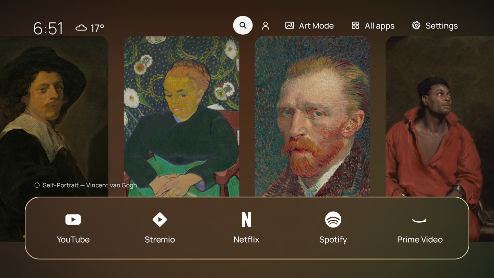
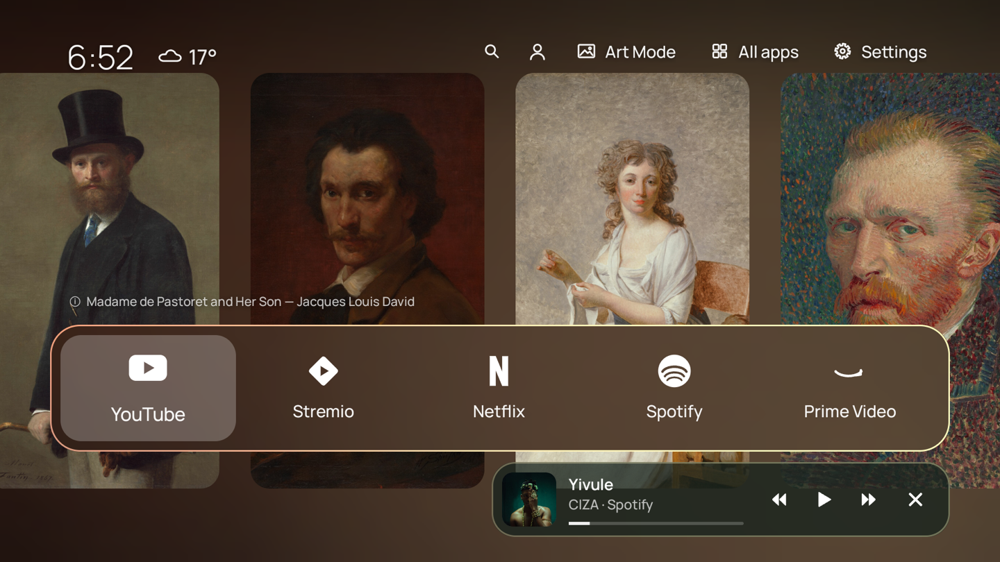
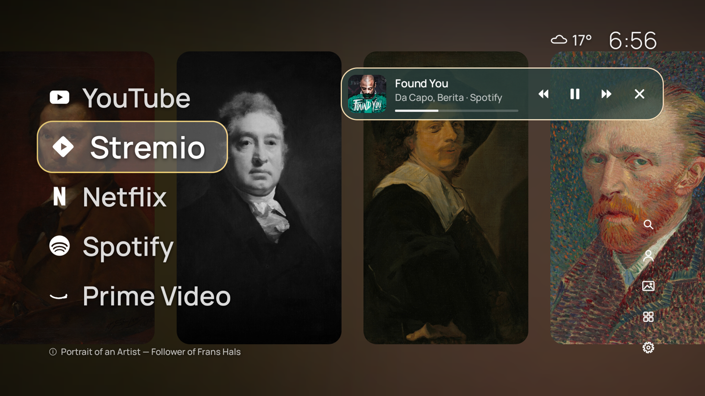
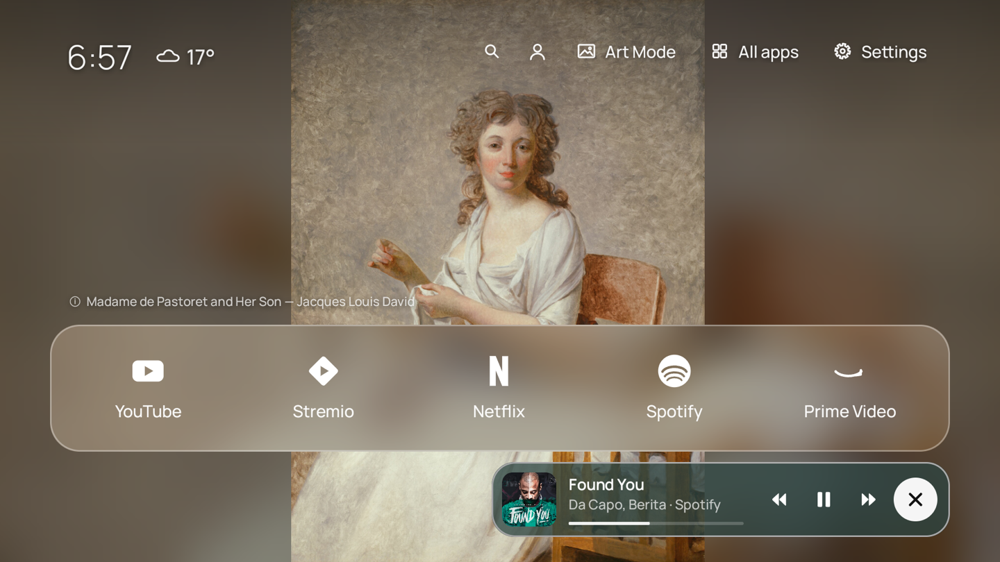
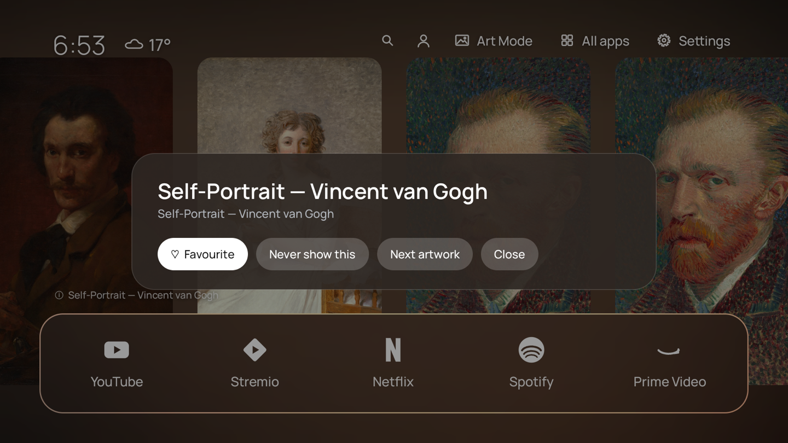
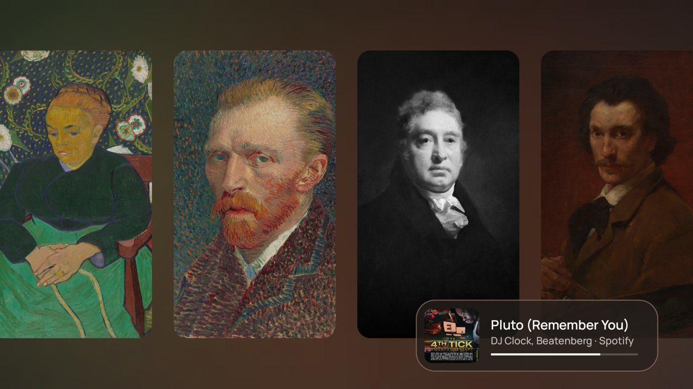
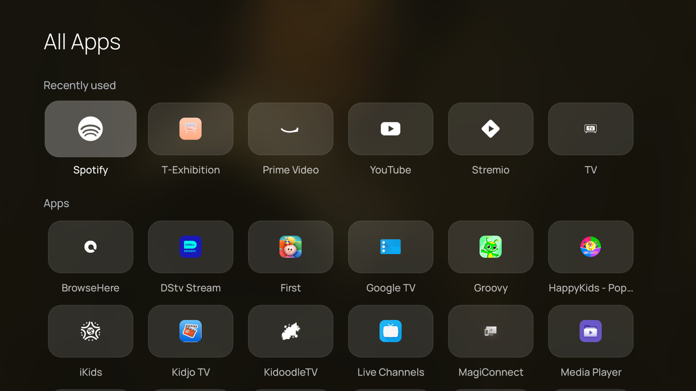
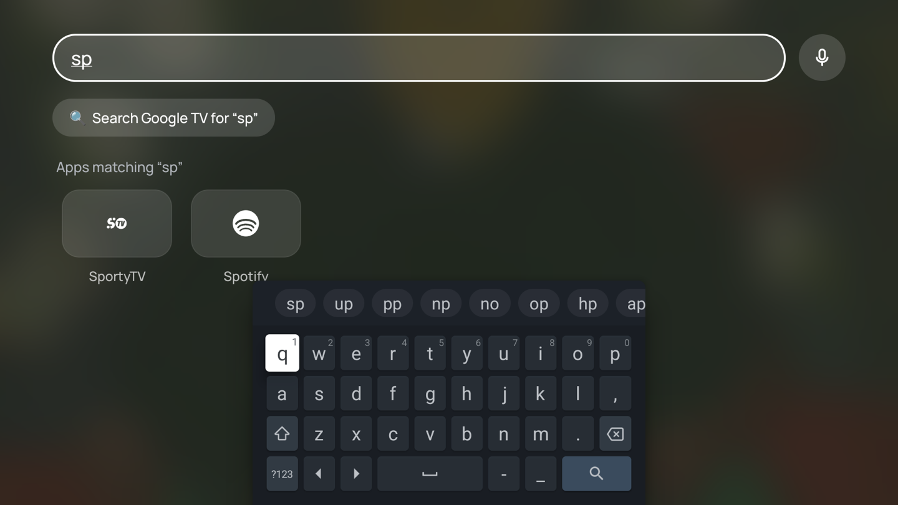
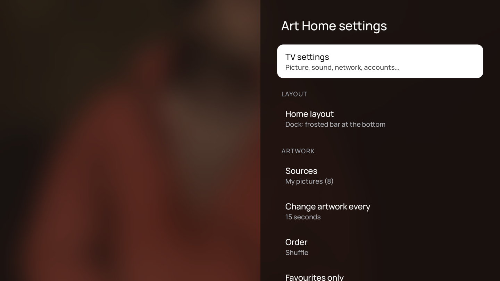

# Art Home

A home screen (launcher) for Android / Google TV that turns the TV into an art frame: your
artwork or photos fill the screen, with a minimal, Apple TV–style set of apps on top.

It was built for a **TCL NXTFRAME** art TV (Google TV, Android 14), where the stock Google TV
home can't show artwork behind its rows, but it works on most Android TV devices.



> Screenshots use public-domain paintings from the
> [Art Institute of Chicago](https://www.artic.edu/open-access) open-access collection.

---

## Contents

- [Features](#features)
  - [Two home layouts](#two-home-layouts)
  - [Artwork sources](#artwork-sources)
  - [How artwork is shown](#how-artwork-is-shown)
  - [Artwork details and the info card](#artwork-details-and-the-info-card)
  - [Now playing](#now-playing)
  - [Apps, All Apps and search](#apps-all-apps-and-search)
  - [Clock and weather](#clock-and-weather)
  - [Profiles](#profiles)
  - [Idle mode, night mode and frames](#idle-mode-night-mode-and-frames)
  - [Adding photos from your phone](#adding-photos-from-your-phone)
  - [Updating without a computer](#updating-without-a-computer)
- [Settings reference](#settings-reference)
- [Remote control](#remote-control)
- [Building and installing](#building-and-installing)
- [TCL / Google TV specifics](#tcl--google-tv-specifics)
- [Optional: capturing NXTFRAME artwork](#optional-capturing-nxtframe-artwork)
- [Privacy and network use](#privacy-and-network-use)
- [Project layout](#project-layout)
- [Credits and licence](#credits-and-licence)

---

## Features

### Two home layouts

Switch between them in **Settings → Layout → Home layout**.

**Dock** — the artwork fills the screen. The time and weather sit top-left; search, profile,
**Art Mode**, **All apps** and **Settings** sit top-right. Your apps live in a frosted-glass
dock along the bottom, each shown as a white monochrome logo with its name.



**List** — big app names down the left, each with a small white logo; the focused one sits in a
frosted pill and grows. Weather and time are top-right, and the five buttons are stacked as
small icons bottom-right.



Both layouts share the same look:

- **Manrope** typeface throughout, with a light-weight clock.
- **Grow animations** — the focused app's logo and name smoothly enlarge; a soft light
  **sheen** sweeps across it, and in the dock it swings in slightly from the direction you moved.
- **Colours from the artwork** — the dock glass, info card and Settings panel are tinted with
  the current picture's main colour.
- **Thin coloured outline** around the dock, the focused list item and the Now playing card.
  While the portrait carousel is showing, the outline is painted with the moving background
  gradient.
- **Screen transitions** — All Apps, Search and Settings fade and zoom in over a blurred copy
  of the artwork.

### Artwork sources

Choose any mix in **Settings → Artwork → Sources**:

| Source | What it is |
|---|---|
| **TCL NXTFRAME art** | Pieces captured from the NXTFRAME's own Art mode gallery (see [capturing](#optional-capturing-nxtframe-artwork)). |
| **The Met** | ~60 public-domain landscape paintings from the Metropolitan Museum of Art's open-access API. |
| **Art Institute of Chicago** | ~60 public-domain paintings from the AIC open-access API (paintings only). |
| **Google Photos shared albums** | One or more public shared-album links; refreshed every 6 hours, with an optional "last 25/50/100 photos per album" limit. |
| **Photos sent from your phone** | Photos uploaded from a phone's browser via the QR code screen. |
| **My pictures** | A folder named `ArtHome` (or `Pictures/ArtHome`) on a USB drive or the TV's storage. |

Museum packs download automatically the first time they're enabled; **Download new museum art**
replaces them with a fresh selection.

### How artwork is shown

- **Change artwork every** 15 s, 30 s, 1 min, 90 s, 5 min, 15 min or 1 h; **shuffle** or in order.
- **Slow pan and zoom** (Ken Burns) across each picture while it's on screen.
- **Landscape** pictures fill the screen.
- **Portrait photos** have three modes (**Settings → Display → Portrait photos**):
  - **One, over a blurred backdrop** — shown whole, with a soft blurred copy filling the sides.

    

  - **Two side by side** — two portraits as a centred pair.
  - **Carousel of four** — two portraits in the centre with one partly visible at each edge; on
    every artwork change the strip glides one place so the next photo slides into the centre.
    Behind them, an **animated gradient** made from the four photos' colours slowly drifts and
    blends to the new colours as the carousel moves. The same gradient flows through the dock's
    glass.

### Artwork details and the info card

A small label (bottom-left) names the current piece. Select it — or press the remote's **Info**
button — to open the **info card**:



- **Title, artist and description** for museum pieces and NXTFRAME captures.
- **Place, date and camera** for your own photos, read from their EXIF data; GPS positions are
  turned into place names via OpenStreetMap (e.g. "OCBC Skyway, Marina South, Singapore").
- **Favourite** (with a "Favourites only" setting), **Never show this** (undo in Settings),
  **Next artwork** and **Close**.

### Now playing

When Spotify, YouTube or any app is playing in the background, a card appears under the dock
(under the clock in the List layout) with album art, title, artist, a progress bar and
**⏮ ⏯ ⏭ ✕** controls. ✕ stops playback and closes the app.

- The card takes on the album art's colour and uses the same thin outline as the dock.
- The dock lifts to make room for it, and drops back when nothing is playing.
- When the screen goes idle it stays visible and becomes a compact **music mode** panel
  (controls hide until you press a key).

  
- It needs notification access (granted once over ADB; see [installing](#building-and-installing)).

### Apps, All Apps and search

- The dock/list shows up to 8 apps; long-press **OK** (or **Menu**) on one to move it or remove it.
- **All Apps** lists **Inputs** (HDMI 1–4, optional), **Recently used** (optional) and every app,
  6 per row. Long-press an app to add it to the home screen or hide it.

  

- Apps whose icons can't be turned into a clean white logo keep their colour icon.
- **Search** filters your apps as you type and hands the query to Google TV search for movies and
  shows; the mic button starts Google voice search. Home always returns to Art Home, even from
  Google's results.

  

### Clock and weather

A light clock plus current weather (icon and temperature) from
[Open-Meteo](https://open-meteo.com). Location is estimated from your internet connection unless
you type a city in **Settings → Weather**; Celsius or Fahrenheit. Updates every 30 minutes.

### Profiles

- The **profile** button opens Google TV's account switcher.
- **Show Art Home on** — choose which Google TV profiles get Art Home; others keep the normal
  Google TV home. Kids profiles always use the Google TV kids home (Art Home quietly steps aside
  instead of showing "App isn't available").
- Profile names are learned automatically from the switcher; a manual override is available.
- Optional **skip "Who's watching?"** at startup, using the last profile.

### Idle mode, night mode and frames

- **Hide apps when idle** (never / 30 s / 2 min / 5 min): everything fades so only the art shows,
  the dock slides away, and the Now playing card becomes music mode. Any key brings it back.
- **Night mode** dims the art with a warm tint during chosen hours (e.g. 22:00–06:00); the clock
  and Now playing card stay bright.
- **Frame**: none, white mat, or gallery frame (dark frame with a light mat).

### Adding photos from your phone

**Settings → Add photos from your phone** shows a QR code. Scan it on a phone on the same Wi-Fi,
pick photos, and they appear on Art Home as they arrive (resized to 2560 px, turned upright, with
their date/camera/place details). Re-sending a photo replaces an older low-quality copy.

The upload page only runs while that screen is open, only accepts devices on your home network,
and needs a one-time code built into the QR code.

### Updating without a computer

The same page accepts a new `ArtHome.apk`; the TV asks you to confirm before installing.

---

## Settings reference

Open with the **Settings** button on the home screen.



| Section | Setting | Options |
|---|---|---|
| — | TV settings | Opens the regular Android TV settings |
| Layout | Home layout | Dock / List |
| Artwork | Sources | see [Artwork sources](#artwork-sources) |
| | Google Photos album links | one link per line |
| | Photos per album | All / last 25 / 50 / 100 |
| | Refresh albums now | — |
| | Download new museum art | — |
| | Change artwork every | 15 s … 1 h |
| | Order | Shuffle / In order |
| | Favourites only | On / Off · Clear favourites |
| | Show hidden artworks again | — |
| Display | Frame | None / White mat / Gallery frame |
| | Portrait photos | One / Two side by side / Carousel of four |
| | Slow pan and zoom | On / Off |
| | Night mode | Off / dim during chosen hours |
| | Clock · Artwork title | Shown / Hidden |
| | Hide apps when idle | Never / 30 s / 2 min / 5 min |
| Weather | Weather on home screen · Location · Temperature | Shown/Hidden · Automatic or a city · °C/°F |
| Apps | Inputs in All Apps · Recently used in All Apps | Shown / Hidden |
| | Hidden apps · Reset home apps | — |
| Profiles | Show Art Home on · Current profile · Skip "Who's watching?" | — |
| Pictures | Add photos from your phone | QR code upload |
| About | Update Art Home | upload a new APK |

---

## Remote control

| Where | Key | Action |
|---|---|---|
| Home | ← → (dock) / ↑ ↓ (list) | Move between apps |
| Home | ↑ from the dock | Artwork label, then the top buttons |
| Home | ↓ from the dock | Now playing controls |
| Home | OK | Open app / button |
| Home | Long-press OK or Menu | Move or remove the app |
| Home | Info | Artwork info card |
| Home | Search | Search |
| Anywhere | Home | Back to Art Home |
| Idle | any key | Bring the home screen back |

---

## Building and installing

No Gradle: the APK is built straight from the Android SDK command-line tools.

**Requirements:** Android SDK with `build-tools` 36.1.0 and `platforms/android-34`, JDK 17,
a debug keystore at `~/.android/debug.keystore`.

```bash
./build.sh                       # → build/ArtHome.apk
```

Install on a TV with ADB debugging enabled (`TV` is the TV's IP and port):

```bash
export TV=192.168.1.50:5555
adb connect $TV
adb -s $TV push build/ArtHome.apk /data/local/tmp/ArtHome.apk
adb -s $TV shell pm install -i com.android.vending -r /data/local/tmp/ArtHome.apk

# Let the Home button open Art Home (Google TV ignores the normal "default home" setting)
adb -s $TV shell settings put secure enabled_accessibility_services \
    com.eric.artlauncher/com.eric.artlauncher.HomeRedirectService
adb -s $TV shell settings put secure accessibility_enabled 1

# Now playing card, Recently used, self-update
adb -s $TV shell cmd notification allow_listener com.eric.artlauncher/com.eric.artlauncher.MediaListener
adb -s $TV shell cmd appops set com.eric.artlauncher GET_USAGE_STATS allow
adb -s $TV shell cmd appops set com.eric.artlauncher REQUEST_INSTALL_PACKAGES allow
```

To go back to the stock Google TV home:

```bash
adb -s $TV uninstall com.eric.artlauncher
```

---

## TCL / Google TV specifics

- **Google TV ignores the default-home setting**, so Art Home uses a small accessibility service
  that watches only Google TV's home window and brings Art Home to the front. It also reads the
  profile switcher to learn profile names. This TCL model does not deliver remote keys to
  accessibility services, so a brief Google TV flash on Home is possible.
- **TCL's app-boot guard** blocks sideloaded apps' background services unless they hold the
  `AUTO_START` app-op. Grant it and *write it to disk*, or it's lost on reboot:

  ```bash
  adb -s $TV shell cmd appops set com.eric.artlauncher AUTO_START allow
  adb -s $TV shell cmd appops write-settings
  ```

  If TCL resets it, Art Home shows a red banner telling you to restart the TV.
- Installing with `-i com.android.vending` avoids Android's "restricted settings" block on
  accessibility for sideloaded apps.
- **Don't disable `com.tcl.exhibit`** — it is the NXTFRAME Art mode app (the **Art Mode** button
  opens it).

---

## Optional: capturing NXTFRAME artwork

The NXTFRAME stores its gallery privately, so `cap.sh` / `night_capture.sh` capture it the only
way available to a user: they open Art mode's *ALL Pictures* preview, wait for the on-screen
text to fade, take a screenshot of each piece (saving title, artist and description), and page
through the gallery. `sync_art.sh` then de-duplicates, converts to JPEG and pushes them into
Art Home.

```bash
TV=192.168.1.50:5555 ./night_capture.sh   # ~1.5 h; skips if something is playing
```

Captured artwork is TCL's content: keep it on your own TV. Nothing captured is included here.

---

## Privacy and network use

- **Weather:** Open-Meteo, plus ipwho.is for the automatic location (type a city to avoid it).
- **Photo places:** only GPS coordinates are sent to OpenStreetMap's Nominatim when a photo is
  first indexed.
- **Museum packs:** The Met and Art Institute of Chicago open-access APIs.
- **Google Photos:** only the public shared-album links you enter.
- **Phone upload page:** home network only, one-time code, and only while its screen is open.
- No analytics, no accounts, nothing else leaves the TV.

---

## Project layout

```
AndroidManifest.xml
build.sh                  build without Gradle (aapt2 → javac → d8 → apksigner)
assets/fonts/             Manrope (OFL)
res/                      icon/banner, accessibility config, screen transitions
src/com/eric/artlauncher/
  HomeActivity.java       home screen: artwork, layouts, carousel, info card, dock/list
  HomeRedirectService.java  Home-button redirect + profile detection (accessibility)
  AllAppsActivity.java · SearchActivity.java · SettingsActivity.java · UploadActivity.java
  Apps.java · Tiles.java · Logos.java     app lists, tiles, white logos
  NowPlaying.java · MediaListener.java    Now playing card
  ArtSources.java · ArtPacks.java · ArtMeta.java · LocalIndexer.java · PhotoDetails.java
  GradientField.java · RimDrawable.java · GlowRim.java · Style.java   visuals
  Weather.java · WeatherIcon.java · UploadServer.java · QrCode.java · Prefs.java
cap.sh · night_capture.sh · sync_art.sh   optional NXTFRAME capture tools
make_icons.py             generates the app icon/banner
docs/screenshots/
```

---

## Credits and licence

- Code: MIT — see [LICENSE](LICENSE).
- Font: [Manrope](https://github.com/googlefonts/manrope), SIL Open Font License 1.1.
- Art in the screenshots: public domain, [Art Institute of Chicago](https://www.artic.edu/open-access).
- Weather: [Open-Meteo](https://open-meteo.com) (CC BY 4.0). Places: © OpenStreetMap contributors.
- Not affiliated with TCL, Google, Apple, Spotify or any app shown.
